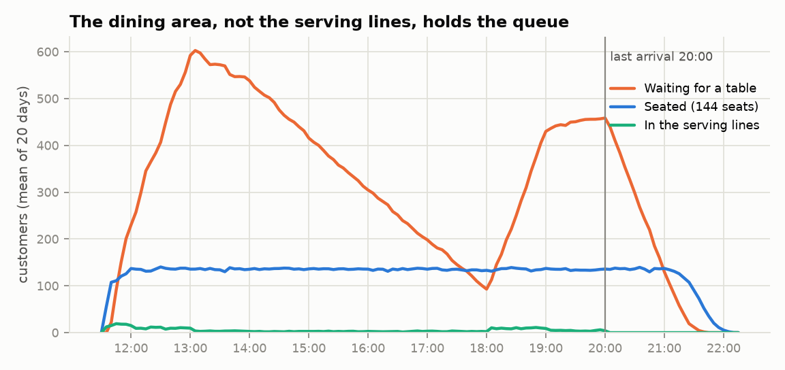
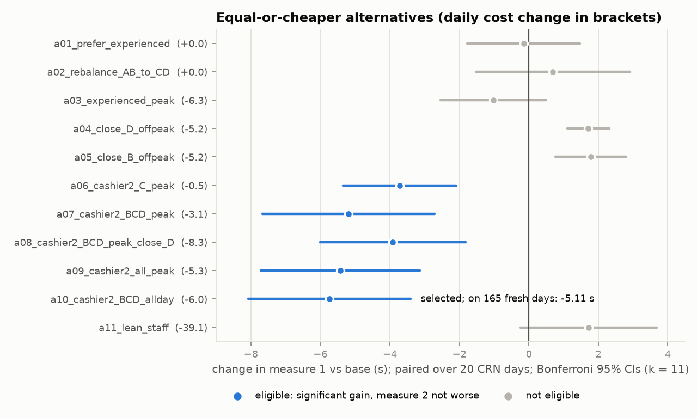
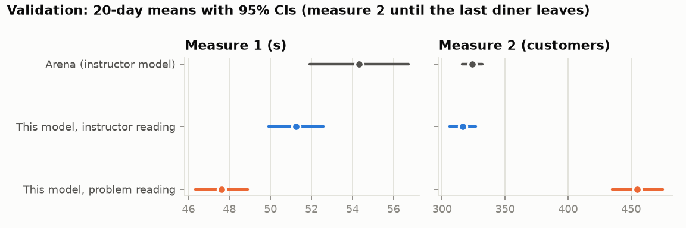

# Cafeteria Simulation

A discrete-event simulation of a university cafeteria in Python (SimPy). It covers output
analysis, a replication-count study, and a statistically tested, cost-constrained search for a
better staffing configuration.

**Context.** This reimplements the term project of IE 305 (Simulation) at Sabancı University,
Fall 2023-24.
- The course project was a group project, built in Rockwell Arena.
- This repository is my own reimplementation from the problem statement, written in open,
  tested Python, so that every modelling choice is explicit and every number can be re-run.
- The original Arena models are not included. Their outputs are used only as validation targets
  (see [Validation](#validation)).

## Results at a glance

| Question | Answer (seed 20231128) |
|---|---|
| Measure 1: mean time from arrival to end of payment | **47.6 s ± 1.3** (95% CI, 20 replications) |
| Measure 2: time-average number of customers in the cafeteria | **491 ± 23** (95% CI, 20 replications) |
| Replications for a 10 s half-width on measure 1 | **3** (n0(h0/h)^2 gives 2; the t-search gives 3; 96.5% of 200 repeated 3-replication experiments met the target) |
| Best equal-or-cheaper alternative (11 screened) | A second cashier at lines B, C and D, paid for by leaner shelf-worker staffing. Cost 137.15 vs 143.10 (-4.2%). Measure 1 **-5.11 s** [-5.69, -4.54], **p = 3e-46** (paired t, 165 fresh CRN pairs). Measure 2 unchanged (-1.0 [-2.9, +0.8], p = 0.22) |
| Agreement with the instructor's Arena model, under its own readings | Measure 2: 316 ± 10 vs 324 ± 8 (p = 0.22). Measure 1: 51.2 ± 1.3 vs 54.3 ± 2.4 s (p = 0.026) |
| Runtime | 0.75 s per simulated day on one core; 20 days in about 4 s on 4 processes |

## The system in brief

The full description is in [docs/problem.md](docs/problem.md), written in my own words and with
a table of every parameter.

- **Arrivals.** Customers arrive from 11:30 to 20:00, alone or in groups of up to six, at a rate
  that changes over the day.
- **Serving lines.** Each customer joins one of four lines by meal type: A for vegan, B or D
  (whichever is shorter) for the standard dish, C for salad.
- **Stations.** Each line has seven stations (tray, dessert, main, side, soup, cutlery, payment).
  Each food station has a small shelf that can run empty.
- **Sauce table and dining.** After paying, a customer may stop at a sauce table (10 places).
  Groups then re-form and look for a table: 24 tables of 6 seats.
- **Workers.** Two working areas, one per pair of lines, keep the lines supplied, in priority
  order: replace empty food containers, refill cutlery, top up shelves. Inexperienced workers are
  40% slower and are paid 1/1.3 of an experienced worker's wage.

The two performance measures are: (1) the mean time from arrival to the end of payment, and
(2) the time-average number of customers in the cafeteria, serving lines and dining hall together.

## Model

```
src/cafesim/
  arrivals.py   non-homogeneous Poisson arrivals by thinning; group-size distribution
  model.py      SimPy processes: customer flow, stations, payment, sauce table, regrouping, dining
  workers.py    shelves, containers and cutlery; prioritized task pool; schedules; experience levels
  seating.py    table choice (empty first, else least occupied that fits); FIFO table queue
  stats.py      tally and time-persistent statistics (with full change logs)
  costs.py      daily labour cost from the schedule
  streams.py    13 named random-number streams per replication, for common random numbers
  experiment.py replications in parallel (at most 4 processes)
  analysis.py   t-intervals, replication counts, paired-t, Bonferroni, CRN variance ratio
  cli.py        `cafesim run | compare | cost`
```

Design points that matter for the analysis:

- **Customers are drawn at arrival.** Every random attribute of a customer (meal, items wanted,
  station times, payment type and time, sauce visit, eating time) is drawn when they arrive, in
  arrival order, from its own stream. So replication *r* of any configuration serves exactly the
  same customers, and the configurations are paired by common random numbers (CRN). Tests check
  that arrivals and customer attributes are identical across configurations.
- **Worker tasks are a condition, not a queue.** A worker who becomes free takes the
  highest-priority condition that currently holds (an empty container, then empty cutlery, then
  the oldest short shelf). One shelf top-up places one item. An emptied container is therefore
  served before the remaining top-ups, without interrupting a task in progress.
- **The whole day is simulated.** Each day runs until the last diner leaves, so customer
  conservation is checked on every replication. Measure 2 is then integrated over whichever window
  is configured.

### Key modelling decisions

Each decision is a named switch in [configs/base.yaml](configs/base.yaml). The full list, with
the evidence for each, is in [docs/modelling_decisions.md](docs/modelling_decisions.md).

- **Arrival table.** The table rate is read as arrival *events* (groups) per hour, as the
  instructor's model does. This gives about 3,340 customers a day. Reading it as customers per
  hour (scenario `s01`) gives about 2,240.
- **Task 3 plating time.** The assignment's data file was not available. I use NORM(8, 2) s,
  which is the distribution written in the instructor's solution model (`main side soup serving
  time`), truncated at zero.
- **Line choice.** Each customer draws their own meal type. A group's standard eaters share the
  B/D line chosen at arrival. "Shorter" means fewer customers in the line who have not yet paid.
- **Group dining.** A group leaves when its slowest eater finishes, as the problem states. The
  instructor's file encodes the fastest eater instead. This is the main source of disagreement
  with that model (see [Validation](#validation)).
- **Table queue.** Strict FIFO: a large party at the head is not bypassed.
- **Shelf top-ups.** One worker at a time per shelf section, as in the instructor's model.
- **Shift ends.** A worker whose shift ends finishes the task in hand, then leaves.
- **Measure 2 window.** Measure 2 runs from 11:30 until the cafeteria closes, which is after 20:00
  once the serving lines are empty. The average until the last diner leaves (the Arena stop rule)
  is reported as well.

## Results

All numbers come from the committed files under `results/`, produced by the scripts below with
seed 20231128.

### Part 3(a): the base configuration

| Statistic (20 replications) | Mean | 95% half-width | sd |
|---|---|---|---|
| Measure 1, arrival to end of payment (s) | 47.6 | 1.3 | 2.7 |
| Measure 2, customers in cafeteria (11:30 to closing) | 491.5 | 23.5 | 50.1 |
| Measure 2, until the last diner leaves | 455.0 | 19.9 | 42.5 |
| Customers per day | 3,338 | | |
| Daily labour cost (inexperienced worker-hours) | 143.10 | | |

Diagnostics (means over the 20 days, from `results/baseline/summary.json`):

- **Waiting in the lines.** The till is the largest single wait in the serving lines, 7.5 s per
  customer. Then come the cutlery station (1.5 s), each food station (0.8 s) and the tray (0.8 s).
- **Stockouts.** Waiting for an empty shelf costs only 0.4 s per customer.
- **Workers.** They are busy 25-34% of their paid time.
- **Dining hall.** It is the bottleneck. 96% of parties wait for a table, for 59 minutes on
  average, and the last diners leave at about 21:52. Measure 2 is therefore mostly people waiting
  for a table, which no staffing change can affect.



Measure 1 is highest for customers arriving in the opening half-hour, about 65 s, and again in
the evening peak, about 50 s
([figure](results/figures/measure1_by_arrival_time.png)).

### Part 3(b): replications for a 10 s half-width on measure 1

With n0 = 20, h0 = 1.27 s and s = 2.72 s:
- The approximation n ≈ n0 (h0/h)^2 gives **2**.
- The exact search, the smallest n with t(n-1) · s / √n ≤ 10, gives **3**.
- A fresh run of 3 replications gave a half-width of 6.6 s.

A half-width from three replications is itself very noisy, so I repeated the 3-replication
experiment 200 times on disjoint seeds:
- 96.5% of the half-widths met the 10 s target. The median was 4.1 s and the 90th percentile 8.7 s.
- 93% of the intervals covered the pooled 600-replication mean (46.74 ± 0.18 s).

The same rule applied to the instructor model's own pilot (sd 5.2 s) gives 4 replications. A 10 s
target is loose relative to day-to-day variation in this system.
([figure](results/figures/replication_halfwidths.png))

### Part 3(c, d): an equally or less costly alternative

**Candidates.** The 11 candidates in `configs/alternatives/` each cost no more than the base
(143.10). They use four levers:

| Lever | Candidates |
|---|---|
| Dispatch rule | a01: prefer experienced workers |
| Staff mix and allocation | a02: move a worker from AB to CD; a03: more experienced staff at peak; a11: lean staffing |
| Off-peak line closure | a04, a05: close D or B from 14:00 to 18:00 |
| Second cashier at peak, paid for by cutting surplus workers | a06 to a10 |

The second-cashier lever follows from the diagnostics above: the till is the largest queue, while
shelf workers are idle about 70% of the time.

**Stage 1, screening.** Each candidate and the base were run on the same 20 replications (CRN),
with a paired-t test of candidate minus base. Each test was at alpha = 0.05/11 (Bonferroni over
the 11 candidates). A candidate was eligible if it significantly reduced measure 1 and did not
significantly increase measure 2.

| Candidate | Cost | Δ measure 1 (s) | Bonferroni 95% CI | Δ measure 2 | Eligible |
|---|---|---|---|---|---|
| a01 prefer experienced | 143.10 | -0.15 | [-1.77, +1.48] | +2.1 | no |
| a02 rebalance AB to CD | 143.10 | +0.69 | [-1.53, +2.91] | +1.6 | no |
| a03 experienced-heavy peaks | 136.80 | -1.02 | [-2.54, +0.50] | +0.2 | no |
| a04 close D 14-18 | 137.90 | +1.71 | [+1.10, +2.31] | +0.8 | no (worse) |
| a05 close B 14-18 | 137.90 | +1.78 | [+0.77, +2.80] | +0.4 | no (worse) |
| a06 2nd cashier C, peaks | 142.65 | -3.72 | [-5.34, -2.09] | -1.7 | yes |
| a07 2nd cashier B, C, D, peaks | 139.95 | -5.19 | [-7.67, -2.71] | -2.7 | yes |
| a08 a07 + close D 14-18 | 134.75 | -3.91 | [-6.00, -1.82] | -2.3 | yes |
| a09 2nd cashier all lines, peaks | 137.80 | -5.42 | [-7.71, -3.14] | -0.4 | yes |
| **a10 2nd cashier B, C, D, all day** | **137.15** | **-5.74** | **[-8.08, -3.41]** | -3.3 | **yes, selected** |
| a11 lean staff only | 104.00 | +1.72 | [-0.23, +3.67] | +0.4 | no |



**Stage 2, confirmation.** Choosing the best of 11 on the same data biases its estimated gain
upwards. So the selected candidate was re-run against the base on 165 fresh, disjoint
replications (indices 10000-10164), again paired by CRN. The 165 was chosen from the screening sd
of the paired differences, to give a 0.5 s half-width. Both measures were tested at alpha = 0.025
(Bonferroni over the two measures).

| | Base | a10 | Difference (97.5% CI) | p |
|---|---|---|---|---|
| Measure 1 (s) | 47.01 | 41.89 | **-5.11 [-5.69, -4.54]**, i.e. -10.9% | 3.3e-46 |
| Measure 2 | 492.2 | 491.2 | -1.0 [-2.9, +0.8] | 0.22 |
| Daily cost | 143.10 | 137.15 | -5.95 (-4.2%) | |

- **The gain held up, but shrank.** The confirmed gain (-5.11 s) is smaller than the screening
  estimate (-5.74 s), which is the selection bias the second stage guards against.
- **CRN helped.** Pairing cut the variance of the difference by 38% compared with independent
  sampling.
- **How a10 works.** It adds a second till at lines B, C and D from 11:30 to 20:00 and runs 2+2
  workers per area at peak and 1+1 off-peak. Till waiting falls from 6.9 s to 0.5 s per customer.
  Shelf stockout waiting rises from 0.44 s to 0.72 s, a small part of the gain given back.
- **Close runners-up.** Candidates a07 and a09 (second tills only at peak) have intervals that
  overlap heavily with a10's; their differences from a10 were not tested. A manager could prefer
  them for a simpler schedule.

Measure 2 cannot be improved by any of these levers, because it is governed by the 144 seats.
Allowing smaller parties to take free seats ahead of a large party at the head of the queue
(scenario `s04`) would cut it from 491 to 408, at no labour cost. That is a policy change outside
the staffing question, so it is reported as a scenario, not as an alternative.

## Validation

The details are in [docs/validation.md](docs/validation.md), and the generated table in
[results/validation.md](results/validation.md).

**(a) The instructor's solution model.** This is the model handed out for Part 3 (credited to
Sinan Yildirim), whose 20-replication output the group produced for Part 3(a).
- Under the problem's readings, this model gives a much larger measure 2 (455 vs 324, both
  averaged until the cafeteria empties).
- One factor explains almost all of it. The solution file's dining time `15*BETA(1, k) + 15`, in
  Arena's parameter order, is the time of a group's *first* finisher, not its last.
- With that reading and the file's one-line-per-group routing (scenario `s02`), measure 2 agrees:
  316 ± 10 vs 324 ± 8, p = 0.22. The closing time matches within 2 minutes (575 vs 577 min after
  opening).
- Measure 1 is about 3 s lower than Arena's (51.2 vs 54.3 s, p = 0.026). `docs/validation.md`
  lists the remaining differences in task logic that could account for it.

**(b) The group's own Part 2 model.** That model is a one-replication, partial implementation: no
worker, shelf or table-capacity logic, and arrivals entered at a third of the table. With the
same arrival schedule (scenario `s05`), this model's time-average number in the cafeteria is
54.0 ± 1.1, against 57.1 in the single Arena run.



## How to run

Use Python 3.10 or later.

```bash
pip install -e ".[dev]"          # or: pip install -r requirements.txt, and set PYTHONPATH=src

pytest                           # 43 tests, about 10 s
ruff check .

cafesim run configs/base.yaml --reps 20                 # 20 days with CIs
cafesim compare configs/base.yaml configs/alternatives/a10_cashier2_BCD_allday.yaml --reps 40
cafesim cost configs/alternatives/a10_cashier2_BCD_allday.yaml

python scripts/run_baseline.py          # Part 3(a) + interpretation scenarios   (~30 s on 4 cores)
python scripts/replication_analysis.py  # Part 3(b) with 200 x 3 verification    (~3 min)
python scripts/alternatives_study.py    # Part 3(c, d) screening + confirmation  (~3 min)
python scripts/validate.py              # tables vs the Arena reference values   (seconds)
python scripts/make_figures.py          # results/figures/*.png
```

Replications run in at most 4 worker processes. Everything is seeded: the same seed and
replication index reproduce a day exactly.

```
configs/        base.yaml, alternatives/ (11 candidates), scenarios/ (5 interpretation checks)
docs/           problem.md, modelling_decisions.md, validation.md
src/cafesim/    the model and the analysis code
scripts/        the experiments behind every number in this README
tests/          unit and statistical tests
validation/     arena_reference.yaml: aggregate Arena outputs with their sources
results/        small CSV/JSON summaries and the figures
```

## Limitations

- **Task 3 plating time.** The distribution is taken from the instructor's model, not fitted
  here, because the measurement file was unavailable. The model is not sensitive to it: shelf
  waiting is under 1 s per customer.
- **Arrival rate unit.** Reading the table as customers rather than groups changes the scale of
  the problem. Measure 2 falls from 491 to 164 because the dining hall stops being saturated. I
  follow the instructor model's reading; scenario `s01` shows the other.
- **No balking or reneging.** Under the specified capacity, 96% of parties wait for a table, for
  about an hour on average. Real customers would leave or eat elsewhere. The problem does not
  model that, so measure 2 should be read as a statement about seating capacity.
- **Simplified extras.**
  - The walk from the sauce table to the dining hall is not modelled.
  - Trays, plates and food are unlimited, as the problem states.
  - The second-cashier lever assumes a till can be staffed by a second cashier sharing one queue.
- **Validation by reading compiled files.** The Arena comparisons rely on outputs and on model
  expressions recovered as text from compiled files. I could not open the models in Arena. Some
  causes of the remaining 3 s gap in measure 1 are therefore inferred, not verified.

## Provenance and credits

- **Course.** IE 305 Simulation, Sabancı University, Fall 2023-24. The problem was designed by the
  course instructors. The original Arena implementation was a group project.
- **Validation targets.** The instructor's solution model (analyst credited in the file: Sinan
  Yildirim) and its 20-replication output. Only aggregate numbers are used, cited with their
  source files in `validation/arena_reference.yaml`.
- **Not included.** No course material is included: no assignment text, instructor files, Arena
  models or reports. `docs/problem.md` is my own description of the system.
